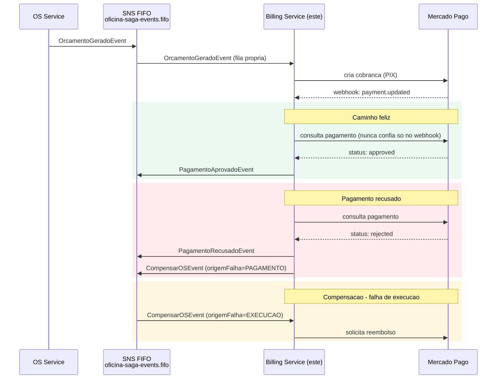

# oficina-billing-service

Segundo microsserviço da Fase 4 do Tech Challenge. Responsável por
orçamento/pagamento e integração com o **Mercado Pago** (PIX/Checkout +
Webhooks). Dono exclusivo de um banco **NoSQL (DynamoDB)** — nenhum outro
serviço acessa essas tabelas diretamente.

| # | Repositório | Responsabilidade |
|---|---|---|
| 1 | [oficina-db-infrastructure](https://github.com/marcosrenansilvafaria-afk/oficina-db-infrastructure) | RDS PostgreSQL (compartilhada entre OS/Execution Service) |
| 2 | [oficina-lambda-auth](https://github.com/marcosrenansilvafaria-afk/oficina-lambda-auth) | Autenticação por CPF + JWT (Lambda + API Gateway) |
| 3 | [oficina-k8s-infrastructure](https://github.com/marcosrenansilvafaria-afk/oficina-k8s-infrastructure) | Cluster EKS compartilhado |
| 4 | [oficina-app](https://github.com/marcosrenansilvafaria-afk/oficina-app) | Hub de documentação, dashboards de observabilidade, Saga E2E |
| 5 | [oficina-messaging-infra](https://github.com/marcosrenansilvafaria-afk/oficina-messaging-infra) | Broker SNS/SQS FIFO + contratos de evento do Saga |
| 6 | [oficina-os-service](https://github.com/marcosrenansilvafaria-afk/oficina-os-service) | Microsserviço de Ordem de Serviço |
| 7 | **oficina-billing-service** (este) | Microsserviço de orçamento/pagamento |
| 8 | [oficina-execution-service](https://github.com/marcosrenansilvafaria-afk/oficina-execution-service) | Microsserviço de fila de produção/execução |

## Sumário

- [Propósito](#propósito)
- [Fluxo (diagrama de sequência)](#fluxo-diagrama-de-sequência)
- [Saga Pattern — consome e publica](#saga-pattern--consome-e-publica)
- [Banco de dados (DynamoDB)](#banco-de-dados-dynamodb)
- [Módulo Mercado Pago](#módulo-mercado-pago)
- [Execução local](#execução-local)
- [Swagger / OpenAPI](#swagger--openapi)
- [Testes e cobertura](#testes-e-cobertura)
- [Deploy no EKS](#deploy-no-eks)
- [Variáveis de ambiente](#variáveis-de-ambiente)
- [Pendências conhecidas](#pendências-conhecidas)

## Propósito

Receber o orçamento gerado pelo OS Service, abrir a cobrança no Mercado
Pago, processar os webhooks de notificação de pagamento com segurança
(validação de assinatura) e reagir a falhas do Saga estornando pagamentos
já aprovados quando a execução do reparo falha depois do fato.

## Fluxo (diagrama de sequência)



## Saga Pattern — consome e publica

Ver [SAGA_PATTERN_SPEC.md](https://github.com/marcosrenansilvafaria-afk/oficina-app/blob/main/docs/SAGA_PATTERN_SPEC.md)
para o desenho completo.

**Consome** (fila `oficina-saga-billing-service.fifo`):

| Evento | Ação |
|---|---|
| `OrcamentoGeradoEvent` | `ReceberOrcamento`: registra o orçamento, cria o `Pagamento` (`PENDENTE`), abre a cobrança no Mercado Pago |
| `CompensarOSEvent` (`origemFalha=EXECUCAO`) | `ReembolsarPagamento`: estorna o pagamento já `APROVADO` |
| `CompensarOSEvent` (`origemFalha=PAGAMENTO`) | no-op — este serviço publicou esse evento, é um eco idempotente |

**Publica** (tópico `oficina-saga-events.fifo`):
- `PagamentoAprovadoEvent` — webhook confirma aprovação.
- `PagamentoRecusadoEvent` + `CompensarOSEvent` (`origemFalha=PAGAMENTO`) — webhook confirma recusa/expiração.

## Banco de dados (DynamoDB)

3 tabelas exclusivas (`terraform/dynamodb.tf`), `PAY_PER_REQUEST` (sem custo
ocioso): `billing-orcamentos`, `billing-pagamentos` (GSIs por
`ordemServicoId` e `mercadoPagoPaymentId`), `billing-webhook-logs`
(append-only, histórico de toda notificação recebida).

## Módulo Mercado Pago

- Porta `application/ports/mercado-pago-gateway.ts` + implementação real
  (`infraestructure/mercadopago/mercadopago-gateway.service.ts`, SDK
  oficial `mercadopago` v2) + implementação fake (usada sem
  `MERCADOPAGO_ACCESS_TOKEN` — dev local/CI, ver Pendências).
- Webhook (`POST /webhooks/mercadopago`, rota pública) valida o header
  `x-signature` (HMAC-SHA256) via `MERCADOPAGO_WEBHOOK_SECRET` e **nunca
  confia no corpo do webhook** — sempre consulta o pagamento real antes de
  decidir aprovado/recusado. Todo webhook (inclusive com assinatura
  inválida) é registrado em `WebhookLog`.

## Execução local

```bash
docker-compose up --build
```

Sobe `amazon/dynamodb-local` (porta `8000`) + cria as 3 tabelas
automaticamente (`create-tables`) + a API em `http://localhost:3002`. Sem
`MERCADOPAGO_ACCESS_TOKEN`, usa o gateway fake automaticamente.

## Endpoints HTTP

| Recurso | Base path | Principais rotas |
|---|---|---|
| Pagamentos | `/pagamentos` | `GET /pagamentos/:ordemServicoId` |
| Webhooks | `/webhooks` | `POST /webhooks/mercadopago` (rota pública, valida `x-signature`) |
| Teste (seam, ver Pendências) | `/test/mercadopago` | `POST /test/mercadopago/proximo-status` — só ativo com `ENABLE_SAGA_E2E_TEST_ENDPOINTS=true` |

Lista completa, com schemas de request/response, no Swagger.

## Swagger / OpenAPI

`http://localhost:3002/docs`.

## Testes e cobertura

```bash
npm test                  # unitarios (Jest)
npm run test:cov          # cobertura do repositorio inteiro
npm run test:cov:critical # cobertura de domain/entities + application/use-cases, gate >= 80%
npm run test:bdd          # BDD (jest-cucumber) - pagamento aprovado + estorno
npm run test:e2e          # end-to-end (supertest)
```

Evidência de cobertura crítica (`test:cov:critical`, `domain/entities` +
`application/use-cases`): **99% statements / 88% branches / 100%
functions / 99% lines**.

Evidência de cobertura **do repositório inteiro** (`test:cov`): **95,21%**
statements / **82,23%** branches / **94,56%** functions / **95,27%**
lines — acima do mínimo de 80% exigido em qualquer uma das duas métricas.
Excluídos da medição: `main.ts`, `*.module.ts` e `JwtAuthGuard` (wiring
puro, sem lógica própria) — mesmo critério usado para delimitar o gate
crítico acima.

BDD (`test/bdd/pagamento.feature`, 2 cenários): pagamento aprovado
(orçamento → webhook aprovado → `Pagamento` `APROVADO` +
`PagamentoAprovadoEvent` publicado) e compensação por falha de execução
(`CompensarOSEvent origemFalha=EXECUCAO` → `Pagamento` `REEMBOLSADO`).

## Simulação E2E do Saga (Sprint 5)

Os testes acima validam este serviço isoladamente. A validação do Saga
coreografado **entre os 3 microsserviços reais** (publicando/consumindo
no SNS/SQS FIFO real, não um emulador) vive em
[`oficina-app/test/saga-e2e/`](https://github.com/marcosrenansilvafaria-afk/oficina-app/tree/main/test/saga-e2e)
— veja o README daquela suíte para pré-requisitos e instruções
(`docker compose -f docker-compose.saga-e2e.yml up` + `npm run test:saga-e2e`,
executado a partir do `oficina-app`). O endpoint
`POST /test/mercadopago/proximo-status` usado por essa suíte (ver
`ENABLE_SAGA_E2E_TEST_ENDPOINTS`) só existe para viabilizar a simulação de
"pagamento recusado" sem credenciais reais do Mercado Pago — fica inerte
(404) fora desse cenário.

## Deploy no EKS

Pipeline em [`.github/workflows/ci-cd-billing-service.yml`](.github/workflows/ci-cd-billing-service.yml),
mesma estrutura do `oficina-os-service`: `lint-test` → `sonarqube`
(condicional) → `docker-build-push` → `deploy` (condicional).

**Pendência**: cluster EKS destruído ao final da Fase 3 — job `deploy`
fica `skipped` até `vars.EKS_DEPLOY_ENABLED=true`.

### Infraestrutura AWS (`terraform/`)

Tabelas DynamoDB provisionadas via Terraform próprio deste repositório
(backend remoto compartilhado, key `oficina-billing/terraform.tfstate`).
A IAM Role de CI/CD (`oficina-billing-service-github-actions`) tem duas
policies anexadas: `oficina-saga-billing-service-policy` (Sprint 1, Saga) +
`oficina-billing-dynamodb-policy` (este repositório, DynamoDB).

## Variáveis de ambiente

Ver [`.env.example`](.env.example): `DYNAMODB_ENDPOINT`/`DYNAMODB_TABLE_*`,
`MERCADOPAGO_ACCESS_TOKEN`/`MERCADOPAGO_WEBHOOK_SECRET`,
`SAGA_TOPIC_ARN`/`SAGA_QUEUE_URL`, `JWT_SECRET` (**idêntico** aos demais
serviços), `ENABLE_SAGA_E2E_TEST_ENDPOINTS` (ausente por padrão — habilita
`POST /test/mercadopago/proximo-status`, usado só pela simulação E2E do
Saga descrita acima).

## Pendências conhecidas

- **Mercado Pago**: nenhuma conta/sandbox real configurada — o módulo usa
  o gateway fake por padrão (determinístico, sem rede). O código contra o
  SDK oficial está completo e testável assim que um `MERCADOPAGO_ACCESS_TOKEN`
  de sandbox existir.
- **SonarCloud**: conta ainda não criada — mesma pendência do OS Service.
- **EKS**: cluster destruído — deploy real ainda não exercido.
